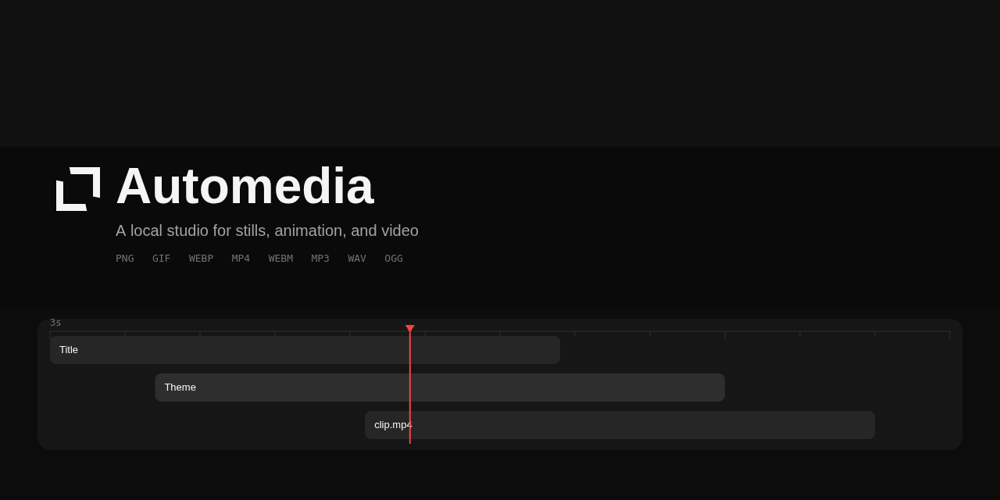
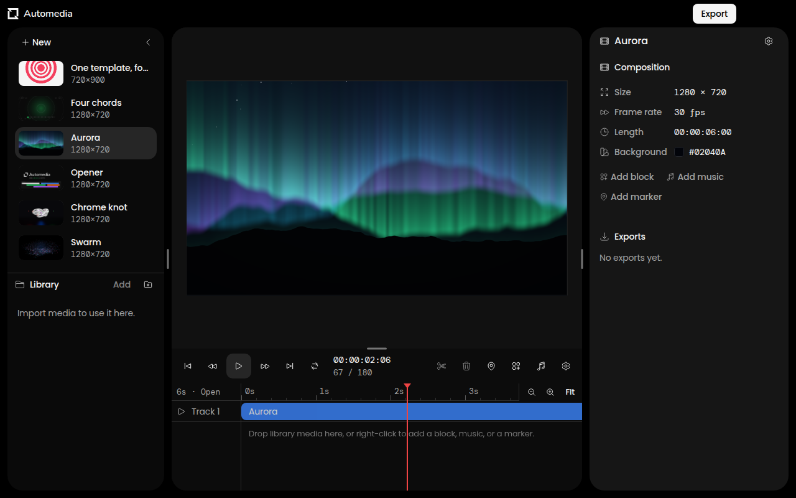

# Automedia



<p align="center">
  <a href="https://github.com/tyrannyme/automedia/actions/workflows/ci.yml"><picture><source media="(prefers-color-scheme: dark)" srcset="https://shieldcn.dev/github/tyrannyme/automedia/ci.svg?variant=outline&amp;size=sm&amp;font=geist&amp;animate=glow&amp;mode=dark"></picture></a>
  <a href="https://automedia.tyranny.me"><picture><source media="(prefers-color-scheme: dark)" srcset="https://shieldcn.dev/badge/site-automedia.tyranny.me-71717A.svg?variant=secondary&amp;size=sm&amp;font=geist&amp;logo=googlechrome&amp;mode=dark"></picture></a>
  <a href="LICENSE"><picture><source media="(prefers-color-scheme: dark)" srcset="https://shieldcn.dev/badge/license-Apache--2.0-71717A.svg?variant=secondary&amp;size=sm&amp;font=geist&amp;logo=apache&amp;mode=dark"></picture></a>
  <a href="https://www.electronjs.org/"><picture><source media="(prefers-color-scheme: dark)" srcset="https://shieldcn.dev/badge/Electron-43-47848F.svg?variant=secondary&amp;size=sm&amp;font=geist&amp;logo=electron&amp;mode=dark"></picture></a>
  <a href="https://www.typescriptlang.org/"><picture><source media="(prefers-color-scheme: dark)" srcset="https://shieldcn.dev/badge/TypeScript-7-3178C6.svg?variant=secondary&amp;size=sm&amp;font=geist&amp;logo=typescript&amp;mode=dark"></picture></a>
</p>

Make stills, animations, and videos out of HTML, CSS, and JavaScript. Build them yourself in the studio, or let AI agents build them for you.

Everything renders on your machine, in Chromium. What you see in the preview is exactly what gets exported. The banner above is an Automedia export.



## Features

- **A project is a web page with a clock.** Animate with CSS, canvas, Three.js, Motion, Tailwind, WebGPU shaders, or anything else that runs in a browser.
- **Music built in.** Write songs in code with [Strudel](https://strudel.cc), and they export with the video.
- **Every common format.** PNG, GIF, WebP, MP4, WebM, MP3, WAV, and OGG, with transparency where the format allows it. No FFmpeg needed.
- **Made for agents.** Agents work through MCP, and many of them can share one library at the same time. They don't need the studio open.
- **Controls.** Add sliders, colors, toggles, and dropdowns to make one design render many ways.

See what it can make at [automedia.tyranny.me](https://automedia.tyranny.me).

## Install

Download the latest build from [Releases](https://github.com/tyrannyme/automedia/releases): an AppImage for Linux, or an installer for Windows. Both update themselves.

You also need [Node.js](https://nodejs.org) 22.18 or newer, because Automedia's engine runs on it.

Open the app and click **New** to start from a blank project or one of the examples.

## Use it with an agent

Add Automedia to your agent's MCP servers:

```json
{
  "mcpServers": {
    "automedia": {
      "command": "pnpx",
      "args": ["github:tyrannyme/automedia#cli", "mcp"]
    }
  }
}
```

You need Node.js 22.18 or newer. The first run takes a minute: it installs Automedia, and the first render downloads a headless Chromium.

The agent's compositions show up in the studio as it works, but it doesn't need the studio open.

For pre-provisioned browsers and CPU-only cloud testing, see
[Headless cloud rendering](docs/cloud.md). Set `AUTOMEDIA_CHROMIUM_EXECUTABLE_PATH`
to use a compatible headless shell without a first-render download.

## Write a composition

A composition is a normal web page. To draw each frame yourself, register a renderer:

```js
const canvas = document.querySelector("canvas");
const context = canvas.getContext("2d");

window.automedia.registerRenderer(({ frame }) => {
  context.clearRect(0, 0, canvas.width, canvas.height);
  context.fillRect(frame * 4, 20, 40, 40);
});
```

Automedia steps through frames one at a time, so exports are smooth no matter how slow a frame is to draw.

## Build from source

You need Node.js 22.18+, pnpm 11+, and [Socket Firewall](https://socket.dev) (`sfw`) on `PATH`.

```bash
PLAYWRIGHT_SKIP_BROWSER_DOWNLOAD=1 sfw pnpm install
pnpm exec playwright install chromium
pnpm dev
```

| Command          | What it does                            |
| ---------------- | --------------------------------------- |
| `pnpm dev`       | Start the studio                        |
| `pnpm check`     | Lint, check formatting, and type-check  |
| `pnpm test`      | Run the tests                           |
| `pnpm build:cli` | Rebuild the agent command in `cli/`     |
| `pnpm make`      | Build the AppImage or Windows installer |

## Learn more

[docs/reference.md](docs/reference.md) covers the project format, runtime API, music, the engine and its CLI, the MCP tools, the localhost API, the website, and releases.

## License

Automedia is licensed under the [Apache License 2.0](LICENSE).
